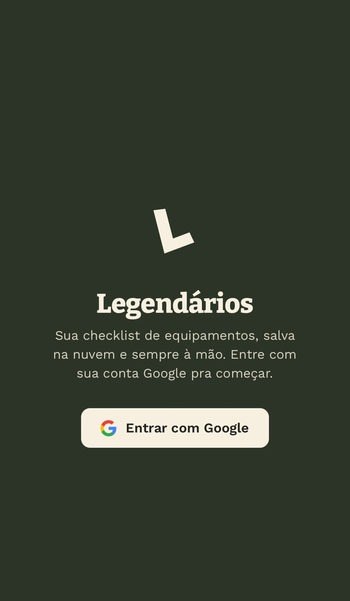
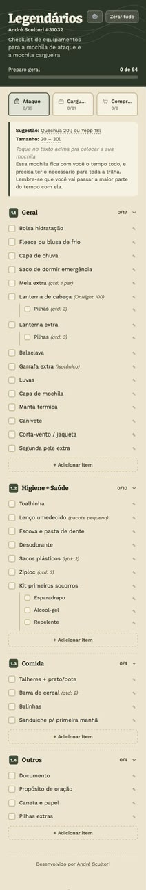
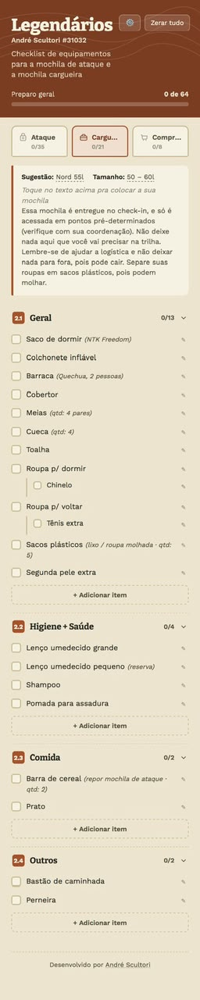
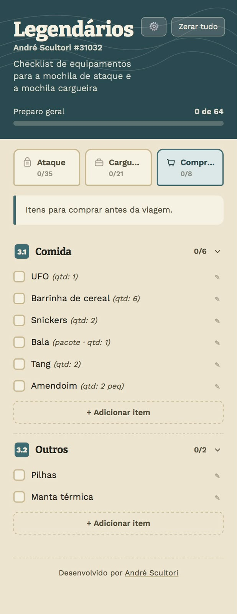
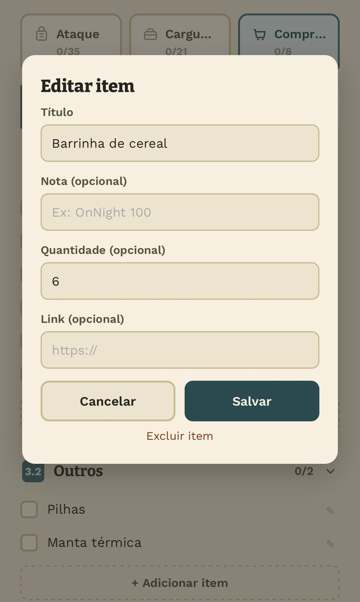

[🇧🇷 Português](README.md) | 🇺🇸 English

# 🎒 Legendários — Gear Checklist

A trekking gear checklist, saved to the cloud and always within reach — no more paper lists getting lost between the daypack and the cargo bag.

A **free** web app for members of the **Legendários** trekking group to organize what to pack in their two trail bags (attack pack and cargo pack) and what's still left to buy, with progress saved per user to the cloud.

> This is the actual app used by the group in production — login is done with a real Google account, and data lives in the group's real database. There's no separate demo mode; the screenshots below show the interface running with a real account (mine).



## The original problem

Before this, the gear list floated around as loose text or a spreadsheet — every member kept their own version, with no standard split between the daypack (the one that stays with you the whole trail) and the cargo pack (handed over at check-in, only accessed at pre-set points). Easy to forget an item, easy to lose track of what's already packed or bought.

## The solution

```
Google login
      ↓
Profile created in Supabase (name, member number, trail, first TOP)
      ↓
Default checklist auto-seeded (3 packs, sections, items and sub-items)
      ↓
Progress checked item by item, saved automatically to the cloud
```

The result: every member opens the app and sees exactly what's left to pack in each bag, and can adjust the list (add, edit, remove items) without touching anyone else's.

## The checklist itself

- **Three packs organized as tabs** — Daypack, Cargo, and To Buy — each with its own progress and accent color
- **Numbered, collapsible sections** (General, Hygiene + Health, Food, Other), each showing a completed-item count
- **Items with sub-items** — e.g. "Head lamp" nested with "3 batteries," each checkable on its own
- **Optional notes, quantity, and link** per item (e.g. suggested model, purchase link)
- **Inline editing of pack suggestion and size** directly in the text, no modal needed
- **Add, edit, and delete items** in any section, at any time
- **Overall and per-pack progress bar**, updating instantly as items get checked
- **"Reset all"** with confirmation, to start fresh before a new trip






## Checklist presets

Beyond editing item by item, each member can build their own checklist from scratch and save it as a **preset** — a mold with no checkmarks that can be restored anytime, or shared with another member via a 10-character code / link.

- **1 preset per user** on the free tier (the data model already supports more than one; the limit is enforced server-side)
- **Restoring** (your own preset, a preset shared by someone else, or the default base list) always asks for confirmation, clears all checkmarks, and creates an **automatic backup** of the current list (checkmarks included) — you can undo it once
- **Sharing** generates a short code that always points at the preset's *current* content; revoking the code doesn't delete copies other users already imported

### Data model

Four tables in `public`, same `lgndcheck_` prefix, RLS on, zero privileges for `anon`:

| Table | What it holds |
|---|---|
| `lgndcheck_presets` | The preset's snapshot (JSON, no checkmarks) + an optional `share_code` |
| `lgndcheck_entitlements` | Per-user preset limit (no row = 1) |
| `lgndcheck_list_backups` | Automatic backup (with checkmarks) taken before any restore — one per user, the most recent |
| `lgndcheck_share_rate_limit` | Counter of share-code lookup attempts (10/min) |

Every write to these tables goes through the RPCs below — there's no direct insert/update policy for the user.

### RPCs (`SECURITY DEFINER`, `authenticated` only)

| RPC | What it does |
|---|---|
| `lgndcheck_salvar_preset_da_lista_atual(name, replace_id?)` | Builds the snapshot from the user's own current list server-side (never accepts client JSON) and creates or replaces the preset |
| `lgndcheck_aplicar_preset(id)` | Restores one of the user's own presets |
| `lgndcheck_resetar_para_base(base_snapshot)` | Restores the default base list |
| `lgndcheck_desfazer_ultima_substituicao()` | Restores the most recent backup and deletes it |
| `lgndcheck_compartilhar_preset(id, activate)` | Generates or revokes the `share_code` |
| `lgndcheck_ver_preset_compartilhado(code)` | Preview of a shared preset (name, owner, per-pack item count, titles) — never the owner's email |
| `lgndcheck_aplicar_preset_compartilhado(code)` | Restores another user's preset directly |
| `lgndcheck_salvar_preset_compartilhado(code, replace_id?)` | Imports the user's own copy of a shared preset |

Migrations: [`supabase/migrations/20261016000000_user_presets.sql`](supabase/migrations/20261016000000_user_presets.sql) and [`supabase/migrations/20261017000000_lgndcheck_presets_restore_e_desfazer.sql`](supabase/migrations/20261017000000_lgndcheck_presets_restore_e_desfazer.sql).

### Raising a user's preset limit

The paid tier with more than 1 preset doesn't have a purchase flow in the UI yet, but the backend already supports it — just one row in the entitlements table:

```sql
insert into public.lgndcheck_entitlements (user_id, max_presets)
values ('<user-uuid>', 3)
on conflict (user_id) do update set max_presets = excluded.max_presets;
```

## Tech stack

| Layer | Technology |
|---|---|
| Frontend | Plain HTML, CSS and JavaScript — no framework, no build step |
| Backend / data | [Supabase](https://supabase.com) (Postgres) |
| Auth | Supabase Auth with Google OAuth login |
| Typography | Google Fonts (Bitter + Work Sans) |

## Why no framework

The whole app lives in a single `index.html`. That's a deliberate choice: it's a small project with a well-defined scope, for one specific group — no bundler, no build pipeline, no dependencies beyond the Supabase JS client loaded from a CDN. Any browser can open the file directly, with no deploy step, and maintenance stays trivial: one person, with no frontend stack, can edit the file and ship it.

Data security doesn't rely on hiding the Supabase `anon key` (it's meant to live client-side) — it relies on the Row Level Security policies configured on the database, which restrict every user to reading and writing only their own data.

## Architecture

All the logic lives in [`index.html`](index.html):
- Supabase tables used: `lgndcheck_profiles`, `lgndcheck_checklist_items`, `lgndcheck_pack_meta`, plus the 4 preset tables (see section above) — `lgndcheck_` prefix because the Supabase project is shared with other apps
- Default item template (`TEMPLATE`) used to seed a new user's checklist on first login, and converted (`templateToSnapshot`) into the snapshot format used by "Restore base list"
- Auth and sign-up flow (`boot`, `afterLogin`, `seedDefaultItems`)
- Pack and section rendering (`renderPack`, `buildSections`)
- Presets (`loadPresetState`, `renderPresetSection`, `openRestoreConfirm`, the share/import flow)

## Running locally

No build step — just serve the static file:

```bash
git clone https://github.com/andrescultori/lgnd-checklist.git
cd lgnd-checklist
python3 -m http.server 8000
# open http://localhost:8000
```

To run it with your own data (instead of the real Legendários database), create a Supabase project, replicate the `lgndcheck_profiles`, `lgndcheck_checklist_items`, and `lgndcheck_pack_meta` tables, and swap `SUPABASE_URL` and `SUPABASE_ANON_KEY` at the top of the `<script>` in `index.html`.

---

*This repository is made public for professional portfolio purposes. It's the real system in production for the Legendários group — see the license section for the code's terms of use.*

Built by [André Scultori](https://github.com/andrescultori)  ·  © 2026  ·  [GitHub](https://github.com/andrescultori/lgnd-checklist)
